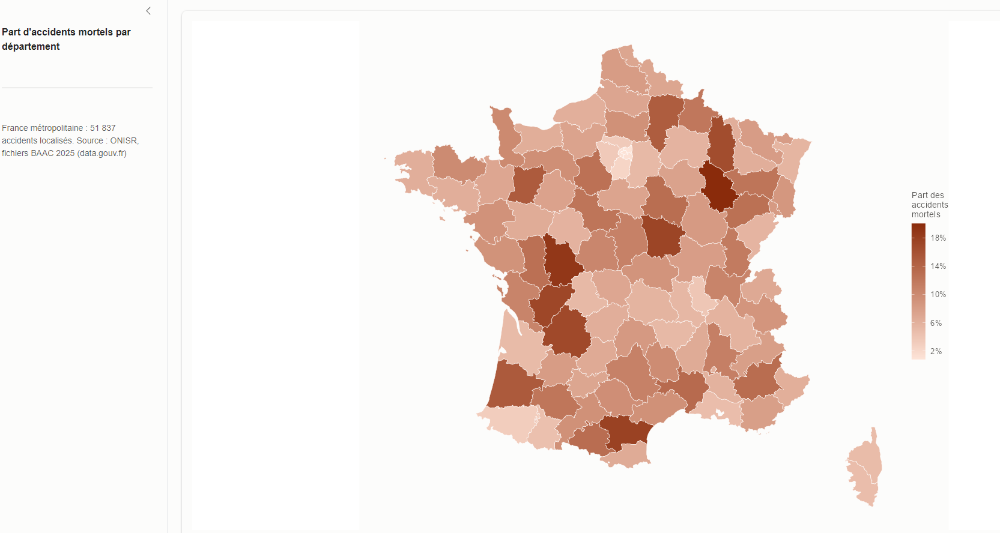
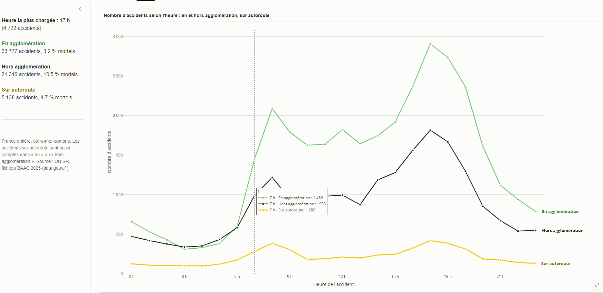

## Partie 1 : Règles de lisibilité (règles 7 à 16)

### Règle 7 : Étiquettes et graduations lisibles
- **Problème :** graduations trop serrées, police trop petite ou étiquettes inclinées. Le lecteur doit déchiffrer les axes avant de lire les données.
- **Correction :** réduire le nombre de graduations, agrandir la police et garder le texte horizontal. Si les étiquettes ne tiennent pas, on simplifie le graphique plutôt que de faire pivoter le texte.
- **Dans mes visualisations :** sur la courbe, tous les textes sont horizontaux et les nombres de l'axe vertical ont un séparateur de milliers (« 2 500 »).

### Règle 8 : Accessibilité des couleurs
- **Problème :** trop de couleurs, ou des teintes trop proches, qui se confondent à l'impression, au vidéoprojecteur ou pour un lecteur daltonien.
- **Correction :** limiter le nombre de couleurs et choisir des teintes bien distinctes en luminosité.
- **Dans mes visualisations :** la carte utilise une seule teinte, de l'orange clair au brun foncé. La courbe n'a que trois couleurs très différentes : noir, vert clair et jaune. Comme le vert clair et le jaune ressortent peu sur fond blanc, leurs étiquettes sont écrites dans un ton plus foncé.

### Règle 9 : Étiquetage direct
- **Problème :** une légende séparée oblige l'œil à faire des allers-retours entre les courbes et la légende.
- **Correction :** pour deux à quatre séries, écrire le nom de chaque série au contact de la donnée.
- **Dans mes visualisations :** sur la courbe, « En agglomération », « Hors agglomération » et « Sur autoroute » sont écrits au bout de chaque ligne, sans légende.

### Règle 10 : Éviter le chartjunk
- **Problème :** effets 3D, bordures épaisses, ombres, grilles denses. Ces éléments ajoutent du bruit sans information.
- **Correction :** supprimer tout élément qui n'aide pas à comparer.
- **Dans mes visualisations :** la carte n'a ni axes, ni graticule, ni cadre, et les départements sont séparés par un simple trait blanc. La courbe n'a qu'une grille horizontale gris clair, sans grille verticale.

### Règle 11 : Trop de catégories
- **Problème :** avec trop de catégories, on passe son temps à lire les étiquettes au lieu de comparer.
- **Correction :** agréger, filtrer ou découper en petits graphiques.
- **Dans mes visualisations :** pour comparer les 96 départements de métropole, j'ai choisi une carte plutôt qu'un diagramme en barres, qui aurait été illisible. La courbe se limite à trois séries.

### Règle 12 : Trier les barres catégorielles
- **Problème :** des barres dans un ordre arbitraire (alphabétique, ordre du fichier) cachent le classement.
- **Correction :** trier par valeur quand il n'y a pas d'ordre naturel. On garde l'ordre naturel s'il existe (mois, heures).
- **Dans mes visualisations :** les heures ont un ordre naturel, donc la courbe les garde dans l'ordre chronologique, de 0 h à 23 h.

### Règle 13 : Surimpression dans les nuages de points
- **Problème :** dans une zone dense, les points se recouvrent. On ne voit plus la différence.
- **Correction :** transparence, léger décalage aléatoire.
- **Dans mes visualisations :** quand des points se superposent, je ferai varier leur taille selon le nombre d'observations.

### Règle 14 : Précision décimale
- **Problème :** trop de décimales ralentissent la lecture et suggèrent une précision qui n'existe pas.
- **Correction :** adapter la précision à la décision. Deux décimales au maximum, souvent aucune.
- **Dans mes visualisations :** la légende de la carte affiche des pourcentages entiers (« 6 % », « 10 % »), et l'axe de la courbe des nombres entiers.

### Règle 15 : Formatage des dates
- **Problème :** des étiquettes temporelles trop nombreuses ou trop longues deviennent illisibles.
- **Méthode :** d'abord réduire le nombre de graduations, ensuite raccourcir le format, et en dernier recours seulement faire pivoter.
- **Dans mes visualisations :** l'axe de la courbe a une graduation toutes les 3 heures, au format court « 18 h », sans rotation.

### Règle 16 : Économie visuelle
- **Problème :** vouloir tout montrer dilue le message principal.
- **Correction :** simplifier le + possible
- **Dans mes visualisations :** plutôt que de mettre un point pour chaque accident, j'ai fait une heatmap.

## Partie 2 : Visualisations

# Accidents de la route en France (2025)

### 1. Carte : part d'accidents mortels par département

Cette carte présente, pour chaque département de métropole, la part des accidents corporels de 2025 ayant fait au moins un mort, à partir des fichiers BAAC de l'ONISR. Les départements urbains sont les plus clairs, en particulier Paris et la petite couronne, où les accidents sont très rarement mortels. À l'inverse, les départements ruraux sont les plus foncés, comme la Haute-Marne, la Vienne, l'Aude ou la Nièvre. Les accidents y sont moins nombreux mais bien plus graves, sans doute à cause de vitesses plus élevées sur les routes de campagne.

### 2. Courbe : nombre d'accidents selon l'heure

Cette courbe présente le nombre d'accidents corporels de 2025 selon l'heure, en agglomération, hors agglomération et sur autoroute, pour la France entière. Les accidents suivent le rythme des déplacements : très peu la nuit, un premier pic vers 8 h, puis un pic plus fort entre 16 h et 19 h, avec un maximum à 17 h (4 722 accidents). Ce pic du soir est le plus marqué en agglomération, où ont lieu six accidents sur dix (33 777). Les autoroutes suivent le même rythme, mais à un niveau bien plus bas (5 138 accidents). Hors agglomération, les accidents sont moins nombreux mais trois fois plus souvent mortels (10,5 % contre 3,2 %).

